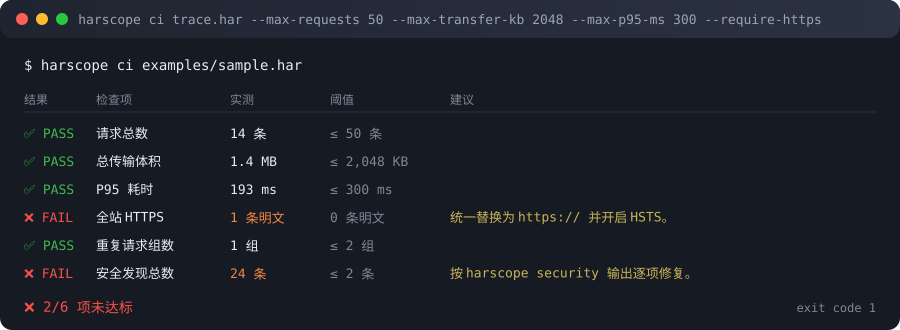

<div align="center">

# 🔬 HarScope

**零依賴的 HTTP Archive (HAR) 分析與效能鑑識工作台**

[](https://github.com/gitstq/harscope/actions/workflows/ci.yml)
[](https://www.python.org/)
[](#-核心特色)
[](./LICENSE)

**零第三方依賴 · 純 Python 標準函式庫 · 離線可用 · 完整型別提示**

<br/>

🌏 [简体中文](./README.md) ｜ **繁體中文** ｜ [English](./README.en.md)

</div>

---

## 🎉 專案介紹

前端效能優化的第一步，永遠是**看清真相**。瀏覽器的開發者工具可以給你一張漂亮的瀑布圖，但它有三個硬傷：資料帶不走、指標無法互相比較、結論進不了 CI。等到你想把「這次發佈到底有沒有變慢」變成流水線上一道硬性的關卡時，才發現手上只剩一張螢幕截圖。

**HarScope** 正是為了解決這個困境而生。它把一份 **HAR（HTTP Archive 1.2）** 檔案當成證據來解剖 —— 誰在拖慢首頁、哪個網域吃掉了大半頻寬、哪些請求被重複發了三次、圖片到底有沒有真的開壓縮、有沒有請求把 `token` 明目張膽地寫在網址裡 —— 全部用數字說話，而且能直接產出一份**單檔 HTML 報告**丟到群組裡，或是變成一個**非零結束碼**把不合格的合併請求擋下來。

最關鍵的取捨是：**HarScope 一行第三方依賴都沒有**。沒有 `requests`、沒有 `pydantic`、沒有 `rich`、沒有 `click`。所有邏輯都建構在 Python 標準函式庫之上 —— 這代表它可以直接塞進任何受限的內網環境、任何 CI 映像檔、任何離線的工作機，裝了就跑，不會有依賴衝突，也不會有供應鏈安全問題。它還內建了一套**純標準函式庫實作的 HAR 錄製器**：即使手邊沒有瀏覽器、沒有 DevTools，也能直接錄下一個頁面的完整載入過程。

> 🎯 **一句話定位**：把「我懷疑這裡有點慢」變成「第 7 個請求 TTFB 331ms，佔首頁載入時間 42%，建議加上 preconnect」。

### 🔍 它解決什麼問題

| 情境 | 以前 | 用 HarScope |
| --- | --- | --- |
| 排查首頁載入緩慢 | 手動拖曳 DevTools，用肉眼找長條 | `harscope slow app.har --by wait` 直接給 TTFB 排行 |
| 找出體積黑洞 | 逐筆點開看 Size 欄位 | `harscope mime` 依 MIME 類型彙總傳輸體積與壓縮節省 |
| 盤點第三方腳本 | 記不住誰載入了誰 | `harscope domains` 依網域拆解請求數、體積、錯誤數 |
| 上線前把關 | 「感覺還行」 | `harscope ci` 用結束碼表達是否達標 |
| 向主管或客戶報告 | 螢幕截圖加手寫文件 | `harscope report` 產出自包含 HTML，點兩下就開 |
| 沒有瀏覽器環境 | 無從下手 | `harscope record <url>` 直接產出 HAR，隱私優先 |

---

## ✨ 核心特色

### 🧊 真正的零依賴

- 📦 **`dependencies = []`** —— 不是「依賴很少」，是**一個都沒有**。
- 🔌 只使用 `dataclasses` / `json` / `csv` / `http.client` / `ssl` / `html.parser` / `urllib.parse` / `zipapp` 這類標準模組。
- 🛡️ 沒有供應鏈投毒風險，內網與離線環境一樣能安裝。
- 🏷️ 內附 `py.typed`（PEP 561），下游專案匯入時自動取得完整型別提示。

### 🧱 容錯式解析：髒資料也能算出結果

真實世界的 HAR 從來都不乾淨。改包工具會掉欄位，Proxy 會把 `_transferSize` 寫成 `-1`，某些匯出檔甚至根本沒有 `startedDateTime`。HarScope 的處理原則是**永不拋出例外，盡量給出數字**：

- 🧯 體積回退鏈：`_transferSize` → `bodySize` → `content.size` → `0`，並記錄降級說明。
- ⏱️ 缺少時間戳記時，依照「緊接上一筆之後」回填，確保時間軸單調且跨度不失真。
- 🔤 數值欄位可能是字串、可能是 `-1`、可能是 `null`，統一正規化後才參與運算。
- 🪧 所有降級行為都不會被靜默吞掉 —— `summary` 底部會列出**資料品質提示**，讓你知道哪些數字是推估值。

### 📊 15 個指令，一個指令回答一個問題

| 指令 | 回答的問題 |
| --- | --- |
| 🧭 `summary` | 這次會話整體健康嗎？ |
| 🌊 `waterfall` | 時間到底花在哪一段？ |
| 🌐 `domains` | 哪個網域最佔資源？ |
| 🧩 `mime` | 體積都被什麼類型的資源吃光了？ |
| 🐢 `slow` | 最慢的是誰？要依總耗時還是 TTFB 排序？ |
| 🐘 `largest` | 最大的是誰？壓縮前後差多少？ |
| 🚦 `status` | 4xx / 5xx 集中在哪些網址？ |
| 📄 `pages` | 單頁情境下的 DOMContentLoaded / onLoad 是多少？ |
| 👯 `dupes` | 有沒有把同一個請求發了好幾次？浪費多少位元組？ |
| 🛡️ `security` | 有沒有明文傳輸、缺 CSP、Cookie 沒加 HttpOnly？ |
| 📤 `export` | 匯出成 JSON / CSV / Markdown / SVG / HTML |
| 📑 `report` | 一鍵產出自包含 HTML 報告（同事點兩下就能看） |
| 🚧 `ci` | 這次改動有沒有讓效能倒退？ |
| 🎥 `record` | 沒有瀏覽器，要怎麼產生 HAR？ |
| 🩺 `doctor` | 環境為什麼怪怪的？ |

### 🚧 CI 原生：用結束碼說話

`harscope ci` 的結束碼有明確語意，可直接接上 GitHub Actions / GitLab CI / Jenkins：

| 結束碼 | 含意 |
| --- | --- |
| `0` | 全部檢查通過 |
| `1` | 有指標超過門檻（不達標） |
| `2` | 輸入錯誤或檔案無法讀取 |

```bash
harscope ci app.har --max-requests 80 --max-transfer-kb 2048 --max-p95-ms 800 --require-https
```



### 🎥 隱私優先的 HAR 錄製器

- 🕸️ 自行覆寫 `HTTPConnection.connect()`，實測**真實的 DNS / TCP / TLS / 送出 / 等待 / 接收**六段耗時，而不是事後推算。
- 🧵 以執行緒池並行抓取第一層靜態資源（預設最多 12 個），模擬瀏覽器的並行載入行為。
- 🔐 **預設不儲存任何回應主體**，只保留體積與耗時 —— 抓取線上頁面時不會把真實使用者資料寫進檔案。
- 🔁 自動跟隨重新導向並記錄每一跳，還原真實的轉址鏈。

### 🎨 終端機可讀性與多元呈現

- 🌈 自動偵測 TTY 與 `NO_COLOR`，在管線中自動關閉色彩，`HARSCOPE_FORCE_COLOR=1` 可強制上色。
- 📐 依**東亞寬字元寬度**計算欄寬，中英文混排不會歪掉。
- 📤 五類匯出：JSON（二次處理）、CSV（Excel 樞紐分析）、Markdown（貼進 PR/Issue）、SVG（嵌入文件）、HTML（自包含單檔報告）。

---

## 🚀 快速開始

### 📋 前置需求

| 項目 | 需求 |
| --- | --- |
| Python | **>= 3.8**（已在 3.8 至 3.13 上驗證） |
| 作業系統 | Windows / macOS / Linux，沒有平台相關程式碼 |
| 第三方依賴 | **無** |
| 磁碟空間 | 約 500 KB |

### ⚡ 三個步驟跑起來

```bash
# ① 安裝（沒有第三方依賴，幾秒搞定）
pip install git+https://github.com/gitstq/harscope.git@v1.0.0

# ② 驗證
harscope doctor

# ③ 看一下範例 HAR 的健檢結果
harscope summary examples/sample.har
```

<details>
<summary>📺 展開看看 <code>summary</code> 的真實輸出</summary>

```
───────────────────────────────── 會話總覽 ─────────────────────────────────
🔬 HAR 會話 範例商城 · 首頁
· 請求 14 筆 ｜ 網域 5 個 ｜ HAR 1.2 ｜ 採集器 HarScope Fixture 1.0

會話跨度     592 ms             累計耗時     1.12 s
併發度       1.89×              平均耗時     80.0 ms
P50          59.6 ms            P95          193 ms
平均 TTFB    42.8 ms            總傳輸       1.4 MB
回應體       1.4 MB             標頭         5.6 KB（0.4%）
解壓體積     1.9 MB             壓縮節省     528 KB（27.1%）
HTTPS        92.9%              快取命中     7.1%

狀態碼分佈
  2xx ██████████████████████░░░░░░      11 78.6%
  3xx ██░░░░░░░░░░░░░░░░░░░░░░░░░░       1  7.1%
  4xx ██░░░░░░░░░░░░░░░░░░░░░░░░░░       1  7.1%
  5xx ██░░░░░░░░░░░░░░░░░░░░░░░░░░       1  7.1%

網域 TOP10
網域                   請求數 傳輸體積 佔比               平均耗時 錯誤
---------------------- ------ -------- ------------------ -------- ----
files.example.com           1   1.0 MB █████████████░░░░░   332 ms
cdn.example.com             7   370 KB █████░░░░░░░░░░░░░  67.3 ms    1
shop.example.com            3  24.3 KB ░░░░░░░░░░░░░░░░░░  46.0 ms
api.example.com             2   5.2 KB ░░░░░░░░░░░░░░░░░░  61.6 ms    1
thirdparty.example.com      1    265 B ░░░░░░░░░░░░░░░░░░  55.7 ms

⚠️  資料品質提示
  - 1/14 筆記錄缺少 startedDateTime
  - 1/14 筆記錄缺少 _transferSize，傳輸體積回退到 bodySize 估算
```

</details>

### 🎥 從零產生一份 HAR

手上沒有現成的抓封包檔案？直接從網址錄一份：

```bash
harscope record https://example.com -o trace.har
harscope waterfall trace.har
harscope report trace.har -o report.html
```

### 🧪 免安裝體驗

```bash
git clone https://github.com/gitstq/harscope.git
cd harscope
PYTHONPATH=src python -m harscope summary examples/sample.har
```

---

## 📖 詳細使用指南

### 🧭 1. 會話總覽 `summary`

```bash
harscope summary app.har              # 人類可讀報表
harscope summary app.har --json       # 結構化輸出，方便串接管線
harscope summary app.har --top 20     # 網域 / MIME 排行放寬到 20 列
```

**怎麼讀**：`併發度` 越接近 1，代表請求幾乎串成一條鏈，通常表示可以做資源提示（`preconnect` / `preload`）把它們並起來；`壓縮節省` 低於 50% 就該回頭檢查文字資源有沒有開 Brotli / gzip；`標頭` 佔比超過 5% 往往是 Cookie 失控的訊號。

### 🌊 2. 瀑布圖 `waterfall`

```bash
harscope waterfall app.har            # 預設顯示最慢的 30 筆
harscope waterfall app.har --top 60
```

七色分段，一眼看出時間花在哪：

| 顏色 | 階段 | 含意 |
| --- | --- | --- |
| 🟪 紫 | Blocked | 排隊等待連線 |
| 🟫 棕 | DNS | 網域名稱解析 |
| 🟧 橙 | Connect | TCP 交握 |
| 🟨 黃 | TLS | TLS 交握 |
| 🟦 藍 | Send | 送出請求 |
| 🟩 綠 | Wait | 等待第一個位元組（TTFB） |
| 🟪 靛 | Receive | 接收回應主體 |

> 💡 綠色（Wait）特別長 → 伺服端有問題；橙色／黃色特別長 → 連線復用沒做好，考慮加上 `preconnect`；靛色（Receive）特別長 → 資源太大或頻寬受限。

### 🌐 3. 網域視角 `domains`

```bash
harscope domains app.har --top 20
```

一眼揪出第三方腳本大戶。「安全」欄位亮紅表示該網域存在明文 HTTP 請求。

### 🧩 4. 資源類型視角 `mime`

```bash
harscope mime app.har
```

同時給出**傳輸體積**、**解壓體積**與**壓縮節省率**。如果某個 `application/javascript` 的節省率是 0%，那就是忘了開壓縮。

### 🐢 5. 慢請求排行 `slow`

```bash
harscope slow app.har --top 10               # 依總耗時
harscope slow app.har --top 10 --by wait     # 依 TTFB（直搗後端緩慢的根本原因）
```

> 🎯 `--by wait` 是最容易被忽略、卻最有價值的參數。總耗時慢通常是資源太大（好解決），TTFB 慢才是真的後端有事。

### 🐘 6. 大資源排行 `largest`

```bash
harscope largest app.har --top 10
```

### 🚦 7. 狀態碼 `status`

```bash
harscope status app.har
harscope status app.har --json | jq '.errors'
```

### 📄 8. 頁面維度 `pages`

```bash
harscope pages app.har
```

適用於 DevTools 匯出、帶有 `pages` 節點的 HAR，給出每個頁面的請求數、傳輸體積、跨度、`DOMContentLoaded` 與 `onLoad`。

### 👯 9. 重複請求 `dupes`

```bash
harscope dupes app.har
```

辨識**同方法 + 同網址**的完全重複請求，並給出去重後可節省的位元組數。這是投報率最高的一檔優化。

### 🛡️ 10. 安全與合規稽核 `security`

```bash
harscope security app.har
harscope security app.har --fail-on high     # 存在高風險發現時結束碼為 1
```

四類檢查，輸出 A 到 E 的分級評分：

| 類別 | 檢查內容 |
| --- | --- |
| 🔐 傳輸安全 | 明文 HTTP、混合內容、HTTP 轉 HTTPS 的轉址 |
| 🧱 回應標頭合規 | HSTS / CSP / X-Content-Type-Options / Referrer-Policy / X-Frame-Options / Permissions-Policy 等是否闕漏 |
| 🍪 Cookie 屬性 | `Secure` / `HttpOnly` / `SameSite` 是否設定 |
| 🕵️ 資訊外洩 | 網址或請求標頭中出現 `token` / `password` / `secret` / `api_key` 等敏感參數、回應標頭暴露伺服器版本號 |

**評分模型**（滿分 100）：傳輸安全 30 分 + 回應標頭合規 30 分 + 安全發現 40 分。刻意保留的高風險項目（混合內容、憑證寫進網址）會讓評分直接掉到 E 級，方便示範門檻效果。

### 📤 11. 多格式匯出 `export`

```bash
harscope export app.har --format json     -o report.json   --entries
harscope export app.har --format csv      -o entries.csv             # 帶 BOM，Excel 點兩下不會亂碼
harscope export app.har --format markdown -o report.md
harscope export app.har --format svg      -o waterfall.svg
harscope export app.har --format html     -o report.html
harscope export app.har --format html     -o report.html --no-security --force
```

| 格式 | 適合拿去做什麼 |
| --- | --- |
| `json` | 二次處理、寫入資料庫、餵給 Prometheus 或自建儀表板 |
| `csv` | 丟進 Excel 做樞紐分析、給非技術同事看明細 |
| `markdown` | 直接貼進 PR、Issue、週報 |
| `svg` | 嵌入 Confluence / Notion / Wiki 文件 |
| `html` | 自包含單檔（內嵌樣式與 SVG），用郵件寄出或直接點開 |

### 🚧 12. CI 品質門檻 `ci`

```bash
harscope ci app.har \
  --max-requests 80 \
  --max-transfer-kb 2048 \
  --max-load-ms 5000 \
  --max-p95-ms 800 \
  --min-cache-ratio 0.3 \
  --max-duplicate-requests 2 \
  --require-https \
  --require-security-headers \
  --max-findings 5
```

所有參數都是選填 —— 只填你真正在意的幾項，其餘不檢查。每一條不達標的項目都會附上**具體優化建議**，而不是只丟給你一個「失敗」。

<details>
<summary>🔧 GitHub Actions 整合範例（複製即可用）</summary>

```yaml
name: Performance Gate
on: [pull_request]

jobs:
  harscope:
    runs-on: ubuntu-latest
    steps:
      - uses: actions/checkout@v4
      - uses: actions/setup-python@v5
        with:
          python-version: "3.11"

      # 零依賴，安裝極快，不需要快取
      - run: pip install git+https://github.com/gitstq/harscope.git@v1.0.0

      # 錄製待測頁面（無頭環境也能用）
      - run: harscope record https://staging.example.com -o trace.har --assets 20

      # 門檻：不達標就以非零碼結束，阻斷合併
      - run: harscope ci trace.har --max-requests 80 --max-transfer-kb 2048 --max-p95-ms 800 --require-https

      # 無論通過與否都保留報告
      - if: always()
        run: harscope report trace.har -o harscope-report.html --force
      - if: always()
        uses: actions/upload-artifact@v4
        with:
          name: harscope-report
          path: harscope-report.html
```

</details>

### 🎥 13. 錄製 HAR `record`

```bash
harscope record https://example.com -o trace.har
harscope record https://example.com -o trace.har --assets 20 --timeout 15
harscope record https://example.com -o trace.har --cross-host          # 允許抓取 CDN 等跨網域資源
harscope record https://example.com -o trace.har --header "Cookie: k=v"
harscope record https://internal.test -o trace.har --insecure          # 自簽憑證環境
```

> 🔐 **隱私聲明**：錄製時**只記錄網址、請求標頭、回應標頭、體積與耗時，不落地任何回應主體內容**，可直接用於對外頁面的巡檢。

### 🩺 14. 環境自我檢查 `doctor`

```bash
harscope doctor
harscope doctor --json
```

輸出 Python 版本、平台、OpenSSL 版本、終端機上色狀態，快速定位「為什麼顏色不見了」或「為什麼 TLS 交握失敗」。

### 🐍 15. 當成 Python 套件整合

HarScope 不只是一支命令列工具，它同時是一套能直接嵌入自有平台的分析函式庫。

```python
from harscope import load, loads, analyze

# 從檔案載入
har = load("app.har")

# 也可以直接從字串或位元組載入
har = loads(open("app.har", encoding="utf-8").read())

analysis = analyze(har)

print(f"請求數: {analysis.total_requests}")
print(f"網域數: {analysis.unique_hosts}")
print(f"會話跨度: {analysis.duration_ms:.1f} ms")
print(f"P95: {analysis.p95_ms:.1f} ms")
print(f"傳輸體積: {analysis.transfer_bytes} bytes")
print(f"壓縮節省: {analysis.compression_saving_ratio:.1%}")
print(f"HTTPS 佔比: {analysis.https_ratio:.1%}")
print(f"併發度: {analysis.parallelism:.2f}x")

# 一次拿到全部摘要（dict，可直接 json.dumps）
summary = analysis.summary_dict()
```

**可用指標總覽：**

| 屬性 / 方法 | 回傳 | 說明 |
| --- | --- | --- |
| `analysis.total_requests` | `int` | 請求總筆數 |
| `analysis.unique_hosts` / `hosts` | `int` / `Set[str]` | 去重後的網域 |
| `analysis.duration_ms` | `float` | 會話跨度（最早開始到最晚結束） |
| `analysis.total_time_ms` | `float` | 所有請求耗時總和 |
| `analysis.parallelism` | `float` | 併發度 = 累計耗時 / 會話跨度 |
| `analysis.average_ms` / `p50_ms` / `p95_ms` / `p99_ms` | `float` | 分位數（線性內插） |
| `analysis.average_wait_ms` / `p95_wait_ms` | `float` | TTFB 相關統計 |
| `analysis.transfer_bytes` / `body_transfer_bytes` / `header_bytes` | `int` | 體積拆解 |
| `analysis.uncompressed_body_bytes` | `int` | 解壓後回應主體總量 |
| `analysis.compression_saving_bytes` / `_ratio` | `int` / `float` | 壓縮收益 |
| `analysis.https_ratio` / `cache_hit_ratio` / `success_ratio` | `float` | 比例類指標 |
| `analysis.insecure_requests` | `int` | 明文 HTTP 請求數 |
| `analysis.status_classes` / `status_codes` | `Dict` | 狀態碼彙總 |
| `analysis.error_entries` / `client_error_entries` | `List[HarEntry]` | 失敗請求明細 |
| `analysis.domain_stats(n)` | `List[DomainStat]` | 網域維度彙總 |
| `analysis.mime_stats(n)` | `List[MimeStat]` | MIME 維度彙總 |
| `analysis.duplicates(top=n)` | `List[DuplicateGroup]` | 重複請求分組 |
| `analysis.redirect_chains()` | `List[List[HarEntry]]` | 還原轉址鏈 |
| `analysis.waterfall(limit=n)` | `List[WaterfallRow]` | 瀑布圖資料 |
| `analysis.page_stats()` | `List[PageStat]` | 頁面維度彙總 |
| `analysis.slowest(n, by="time"\|"wait")` | `List[HarEntry]` | 慢請求排行 |
| `analysis.largest(n)` | `List[HarEntry]` | 大資源排行 |
| `analysis.summary_dict()` | `Dict[str, Any]` | 全部核心指標打包成 dict |

**匯出器與安全稽核也能單獨呼叫：**

```python
from harscope import load, analyze
from harscope.exporters import to_json, to_markdown, to_csv, to_svg_waterfall, to_html_report
from harscope.security import audit

har = load("app.har")
analysis = analyze(har)
sec = audit(har)

print(f"安全評分: {sec.score}/100 ({sec.grade} 級)")
for f in sec.findings:
    print(f"[{f.severity}] {f.category}: {f.message}")

# 產生各類產出物
html = to_html_report(analysis, audit=sec, waterfall_limit=40)
open("report.html", "w", encoding="utf-8").write(html)

open("report.md", "w", encoding="utf-8").write(to_markdown(analysis, audit=sec))
open("entries.csv", "w", encoding="utf-8").write(to_csv(analysis.entries))
open("waterfall.svg", "w", encoding="utf-8").write(to_svg_waterfall(analysis, limit=40))
```

**在自己的程式碼裡複用錄製器：**

```python
from harscope.recorder import record, RecordOptions

options = RecordOptions(
    timeout=15.0,
    max_assets=20,
    max_redirects=5,
    same_host_only=True,
    headers={"Cookie": "session=abc"},
)
har_dict = record("https://example.com", options)   # 回傳標準 HAR dict

import json
json.dump(har_dict, open("trace.har", "w"), ensure_ascii=False, indent=2)
```

**錯誤處理：**

```python
from harscope import load, analyze
from harscope.exceptions import (
    HarScopeError, HarParserError, NetworkRecordError, ExportError,
)

try:
    analysis = analyze(load("app.har"))
except HarParserError as exc:
    print(f"HAR 解析失敗：{exc}")
    for warning in exc.warnings:
        print(f"  警告：{warning}")
except HarScopeError as exc:
    print(f"HarScope 錯誤：{exc}")
```

> 🧯 `HarParserError` 會把**非致命問題**收集到 `exc.warnings` 裡，而不是直接崩潰 —— 在批次掃描成百上千份 HAR 時特別重要。

### 🔤 通用參數

| 參數 | 作用 |
| --- | --- |
| `--json` | 以 JSON 輸出結構化結果，可搭配 `jq` |
| `--no-color` | 關閉 ANSI 色彩（等同於 `NO_COLOR=1`） |
| `--version` | 列印版本號 |
| `-h` / `--help` | 查看說明 |

**環境變數：**

| 變數 | 作用 |
| --- | --- |
| `NO_COLOR=1` | 關閉終端機上色 |
| `HARSCOPE_FORCE_COLOR=1` | 管線重導向時仍強制上色 |

---

## 💡 設計思路與迭代規劃

### 🧠 為什麼堅持零依賴

這是整個專案最核心、也最「反直覺」的一次取捨。

**代價**：放棄了 `requests`（TLS 細節要自己處理）、`pydantic`（資料驗證得手寫）、`rich`（終端機渲染得自己算欄寬）、`click`（argparse 寫到手痠）。程式碼量大約多了 30%。

**收穫**：

1. **可以搬到任何地方** —— 離線工作機、沒有外網的內網、體積受限的 CI 映像檔、`python:alpine` 容器，裝了就能跑。
2. **供應鏈攻擊面為零** —— 沒有間接依賴，不存在某個 transitive dependency 被投毒的風險。對一個**會被放進 CI、能讀到真實 HAR 資料**的工具來說，這件事的重要性遠遠超過省下的那些程式碼。
3. **安裝耗時接近零** —— `pip install` 不需要解析依賴樹，在流水線裡就是乾淨俐落的一步。
4. **不會因為依賴版本打架** —— 不必擔心某個下游專案要求的 `pydantic<2` 跟 HarScope 衝突。

判斷標準很單純：**這東西要在別人的 CI 裡跑。** 一支 CI 工具的依賴，就是所有人的技術債。

### 🧱 為什麼是「先容錯，再計算」

HAR 是**由工具寫給工具看的交換格式**，而寫它的工具有幾十種，品質良莠不齊。如果採用嚴格解析：

- 遇到 `_transferSize: -1` 就報錯 → 使用者只會說「不能用」，而不會感謝你的嚴謹；
- 遇到缺少 `startedDateTime` 就跳過整列 → 統計口徑會悄悄失真，使用者卻渾然不覺。

HarScope 的折衷是：**解析時盡量給值，但同時把降級行為明明白白記進 `notes`，並在 `summary` 底部呈現出來。** 數字可以是推估的，但使用者必須知道它是推估的 —— 這是「鑑識」類工具的最低底線。

### ⏱️ 時間軸回填的一段真實教訓

第一版在回填缺少的時間戳記時，把「之前所有項目的耗時」累加到了缺失項目上，導致會話跨度從真實的 447 ms 被放大到 1467 ms，併發度也從 1.49× 虛高到 2.57× —— 一個看起來「不太好但還能接受」的結果，實際上是完全錯的。修正成「緊接上一筆之後開始」之後，指標立刻回到合理區間。

這件事說明：**效能工具的 bug 不會以崩潰呈現，只會以一個你還滿相信的錯誤數字呈現。** 因此專案中所有與時間、體積相關的指標，都有對應的單元測試做量級斷言。

### 📐 安全評分為什麼不直接扣分

最初的評分是「發現問題就扣分」，結果範例 HAR 直接被扣到 0 分 E 級 —— 因為發現了混合內容與網址裡的憑證。這看起來像在說「你這個站很爛」，但其實傳達不出任何可執行的資訊：到底哪裡最該先修？

改成分段加權之後就好讀多了：**傳輸安全 30 分 + 回應標頭合規 30 分 + 安全發現 40 分**。即使某個站台有高風險發現，只要傳輸與安全回應標頭做得好，仍然能拿下 C 級 —— **評分表達的是「整體安全姿態」，而具體可執行的項目交給 `findings` 清單逐條列出。** 評分給管理者看，清單給工程師看。

### 🗺️ 迭代藍圖

| 版本 | 預計內容 | 狀態 |
| --- | --- | --- |
| **v1.0.0** | 15 個指令、5 類匯出、內建錄製器、126 個單元測試、三語文件 | ✅ 已發佈 |
| v1.1.0 | HAR 檔案差異比對（`harscope diff A.har B.har`）、指標回歸趨勢 | 📋 規劃中 |
| v1.2.0 | Core Web Vitals 近似估算（從 HAR 側推算 LCP / FID / CLS） | 📋 規劃中 |
| v1.3.0 | JSON Schema 層級的 HAR 校驗報告、`--strict` 嚴格模式 | 💡 構思中 |
| v2.0.0 | Prometheus Exporter 與 Grafana 面板樣板、Webhook 告警 | 💡 構思中 |

**明確不做的**：引入第三方依賴、內建瀏覽器自動化、把 HAR 上傳雲端解析、支援 HTTP/3 專屬指標（仰賴伺服端暴露，HAR 層面無法可靠取得）。

---

## 📦 打包與部署指南

HarScope 屬於**工具類 / 函式庫類**專案，因此**不發佈平台專屬安裝檔**，而是提供四種彈性的取得方式。

### 🐍 方式一：pip 安裝（推薦）

```bash
# 安裝指定版本
pip install git+https://github.com/gitstq/harscope.git@v1.0.0

# 升級到最新的 main
pip install --upgrade git+https://github.com/gitstq/harscope.git

# 從原始碼安裝
git clone https://github.com/gitstq/harscope.git && cd harscope
pip install --no-deps .

# 可編輯模式（開發用）
pip install --no-deps -e .
```

安裝後會取得全域指令 `harscope`，另外也有等價的 `python -m harscope` 寫法。

### 📀 方式二：建置散佈套件

```bash
make wheel                     # 產出 dist/harscope-1.0.0-py3-none-any.whl
python -m build                # 同時產出 wheel 與 sdist
pip install dist/*.whl         # 驗證 wheel 可安裝
```

產出的 wheel 是 `py3-none-any` —— 單一 Wheel 通吃所有平台與 Python 版本。

### 🧳 方式三：zipapp 單檔（免安裝、可攜）

```bash
make zipapp                    # 產出 dist/harscope.pyz
python dist/harscope.pyz summary app.har          # 直接使用
python3.11 dist/harscope.pyz waterfall app.har    # 也可以指定直譯器
```

`.pyz` 是把整個套件塞進去的可執行 zip —— **要交給別人只需要傳一個檔案**，對方只要有 Python 就能跑。

### 🏃 方式四：完全免安裝執行

```bash
git clone https://github.com/gitstq/harscope.git && cd harscope
PYTHONPATH=src python3 -m harscope summary examples/sample.har
# 或用封裝腳本
bash scripts/run.sh summary examples/sample.har
```

### 🧪 本機開發與測試

```bash
make install         # 安裝到當前環境
make dev             # 可編輯模式安裝
make test            # 執行 126 個單元測試
make test-net        # 含網路錄製器的測試
make smoke           # CLI 冒煙測試
make clean           # 清除建置產物
```

### 🔁 在 CI 中的部署方式

零依賴代表 CI 整合極度單純 —— 不需要快取依賴、不需要預熱虛擬環境：

```yaml
- run: pip install git+https://github.com/gitstq/harscope.git@v1.0.0
- run: harscope ci trace.har --max-requests 80 --require-https
```

完整範例請見上方「🚧 CI 品質門檻」的 Actions 設定。

### 📁 專案結構

```
harscope/
├── src/harscope/
│   ├── __init__.py       # 套件入口，匯出 load / loads / analyze
│   ├── __main__.py       # python -m harscope 入口
│   ├── model.py          # HAR 1.2 資料模型（容錯、可為空）
│   ├── parser.py         # 解析與時間軸回填
│   ├── analyze.py        # 指標彙總（P50/P95/P99、網域/MIME/瀑布圖）
│   ├── security.py       # 安全與合規稽核
│   ├── exporters.py      # JSON / CSV / Markdown / SVG / HTML 匯出
│   ├── recorder.py       # 純標準函式庫 HAR 錄製器
│   ├── render.py         # 終端機渲染（配色、表格、瀑布圖）
│   ├── cli.py            # 命令列：15 個子指令
│   ├── exceptions.py     # 例外層級
│   └── py.typed          # PEP 561 型別標記
├── tests/                # 126 個單元測試（僅使用標準函式庫 unittest）
├── examples/sample.har   # 範例 HAR 檔案
├── scripts/              # run / build / test 一鍵腳本
├── .github/workflows/    # CI（3 種系統 × 6 個 Python 版本）
├── pyproject.toml        # PEP 517/518 打包中繼資料
├── Makefile
├── CONTRIBUTING.md
├── CHANGELOG.md
└── LICENSE
```

---

## 🤝 貢獻指南

歡迎按 Star ⭐、開 Issue 🐛 與提交 Pull Request 🔧。完整規範請見 [CONTRIBUTING.md](./CONTRIBUTING.md)，重點如下：

### 🔧 快速上手

```bash
git clone https://github.com/gitstq/harscope.git
cd harscope
pip install --no-deps -e .
make test                    # 必須全數通過
```

### 🧾 Angular 提交規範

提交訊息必須遵循 `<type>(<scope>): <subject>`，這是合併的前置條件：

```
feat(analyze): 新增 P99 耗時分位數指標
fix(parser): 修復缺少 startedDateTime 時時間軸回填越界
docs(readme): 補充繁體中文使用範例
refactor(security): 評分改為三段加權模型
test(cli): 覆蓋 ci 指令所有門檻分支
```

允許的 type：`feat` `fix` `docs` `style` `refactor` `perf` `test` `build` `ci` `chore` `revert`。

### 🚫 專案紅線

- ❌ **禁止引入任何第三方執行期依賴** —— 這是專案的立身之本。
- ❌ 禁止降低 Python 相容下界（目前 `>=3.8`）。
- ❌ 禁止刪除或弱化既有的測試斷言。
- ❌ 禁止把回應主體內容寫進輸出或匯出檔案。
- ❌ 修改功能時必須**同步更新三份 README**（簡中 / 繁中 / English）。

### 🐛 開 Issue 請留意

請勿直接貼上含有 Cookie、Authorization 或真實使用者資料的 HAR 原文。請先用 `harscope export --format json` 匯出彙總結果，或手動去敏感化後再附上最小重現片段。

---

## 📄 開源協議說明

本專案以 **[MIT License](./LICENSE)** 開源，這代表你可以：

- ✅ 自由使用、複製、修改、合併、發佈、散佈、再授權與販售副本，**無論是商業或非商業用途**；
- ✅ 用於閉源的商業產品；
- ✅ 無須支付任何費用。

**唯一要求**：在所有副本或實質部分中保留著作權聲明與授權聲明。

**免責聲明**：本軟體依「原樣」提供，不含任何明示或默示的擔保，包括但不限於可商用性、特定用途適用性與未侵權性的擔保。作者或著作權持有人對任何索賠、損害或其他責任概不負責。

完整法律條文請見 [LICENSE](./LICENSE)。

---

<div align="center">

**如果 HarScope 幫你揪出了那個偷偷拖慢首頁的請求，給顆 ⭐ 吧 —— 這是零依賴專案繼續走下去的唯一燃料。**

[⬆ 回到頂部](#-harscope) ｜ [開 Issue](https://github.com/gitstq/harscope/issues) ｜ [貢獻指南](./CONTRIBUTING.md)

🌏 [简体中文](./README.md) ｜ **繁體中文** ｜ [English](./README.en.md)

</div>
